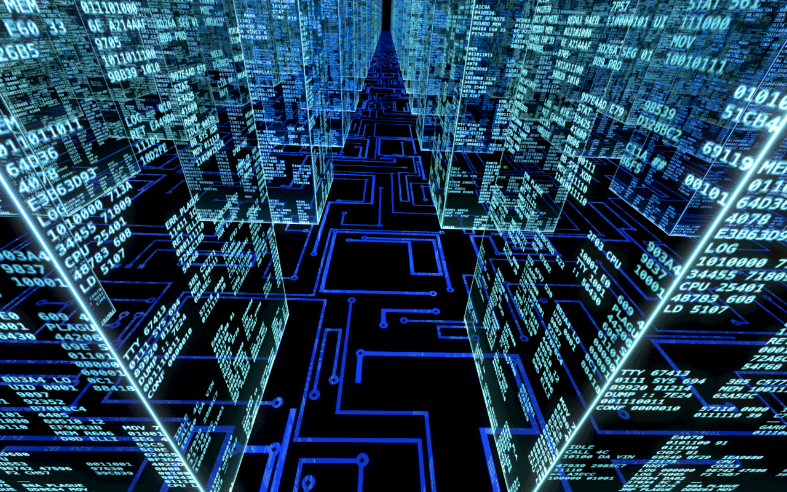
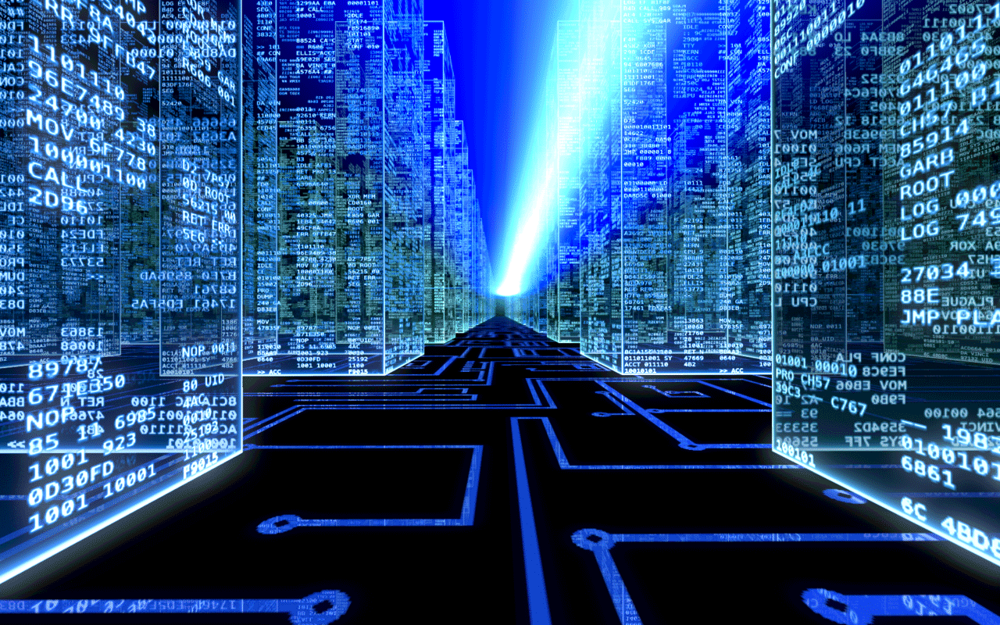

# The Gibson

# Credit Where Credit Is Due
This is a fork of a repo archived by someone that cared enough to keep it alive - I have merely AI slop coded my way to making it work for my purposes; please credit the original maintainers of this work, paulkiernan and John Serafino. They are truly elite.

> "Mess with the best, die like the rest." - Dade Murphey a.k.a. Crash
> Override a.k.a. Zero Cool

A macOS screensaver that flies you through the Gibson from *Hackers* (1995):
canyons of glass towers covered in glowing data, a circuit-board floor whose
traces catch the towers' light, and a low, banking camera.

# Screenshots






# How it got here

1. **John Serafino** built the original Gibson screensaver for Windows on the
   [Irrlicht](https://irrlicht.sourceforge.io) engine
   ([lazerbladegames](https://sites.google.com/site/lazerbladegames/the-gibson)).
2. **Paul Kiernan** ([paulkiernan/hack-the-gibson](https://github.com/paulkiernan/hack-the-gibson))
   pared it down into a windowed OS X app and opened it up to the community.
3. **This fork** rebuilt it as a native macOS screensaver in SceneKit/Metal and
   reworked the look against frames from the film:
   - **Towers:** dark see-through glass covered in bold glowing text that
     flickers, shifting between electric blue and pale cyan with viewing angle
     and over time, with glowing edges and rims. Packed into tight rows like
     the film's canyons, and 15% taller than the original.
   - **Floor:** a generated circuit board (right-angle routing, round vias,
     two trace weights). The floor stays dark; only the traces reflect the
     towers above them.
   - **Camera:** flies low (about a sixth of tower height), banks into turns,
     and swoops over the rooftops once a loop.
   - **Grade:** bloom, saturation, motion blur and cyan pulses streaking
     through the city.
   - **Format:** ships the way Apple's own screensavers do, as an app
     extension (`.appex`) inside `TheGibson.app`, so it runs in its own process
     instead of inside `legacyScreenSaver`.
   - **Performance:** about 35–40% of one CPU core at 60 fps on Apple Silicon.
   - **Code:** the original Irrlicht app is gone from this fork; everything
     is SceneKit/Metal (Objective-C++). The earlier code is still in the git
     history.

# Requirements

- macOS 14 (Sonoma) or later on **Apple Silicon**. The build is arm64 only.
- Xcode Command Line Tools: `xcode-select --install`.
- Nothing else: no Homebrew, no third-party engine.
- Optional: Python 3, only to regenerate the textures (see
  [Regenerating the textures](#regenerating-the-textures)).

# Install the screensaver

```bash
git clone https://github.com/dherberger/hack-the-gibson.git
cd hack-the-gibson
make install-saver
```

(Plain `make` only builds `dist/TheGibson.app`, without installing it.)

`make install-saver` does the following:
- builds `dist/TheGibson.app` with the screensaver extension inside;
- copies it to `/Applications/TheGibson.app`;
- signs it with the best identity in your keychain (Developer ID, then Apple
  Development, then ad hoc);
- registers the extension with `pluginkit`;
- restarts `WallpaperAgent` so the new build is the one that runs;
- removes any old `Gibson.saver` from `~/Library/Screen Savers`.

Then open **System Settings → Screen Saver** and choose **The Gibson**. It
sits with Apple's screensavers, not under "Other". If it doesn't show up, quit
System Settings completely and reopen it.

To set it as the screensaver directly (idle and hot corners), without going
through System Settings:

```bash
make enable-saver
```

This writes the choice into macOS's wallpaper settings. It backs up the
original file first, as `Index.plist.gibson-bak` next to it in
`~/Library/Application Support/com.apple.wallpaper/Store/`.

To remove it:

```bash
make uninstall-saver
```

## The Gibson app

Open `/Applications/TheGibson.app` to change the settings: music on or off,
the track and its volume, flight speed and banking. Changes are saved right
away and apply the next time the screensaver starts. **Preview** (⌘P) opens
the flythrough in a window; Escape closes it.

Opening the app also re-registers the screensaver extension, which helps if
System Settings loses track of it.

To preview from a build without installing:

```bash
make run-app       # opens dist/TheGibson.app
make play          # opens it straight into the game
make scn           # bare preview window: ./src/scn_preview (Escape or Q to quit)
```

## Settings

The app writes to a plain-text file, which you can also edit by hand. It's
created on first run:

```
~/Library/Application Support/TheGibson/config.txt
```

| Key | Default | What it does |
|---|---|---|
| `fly_speed` | `0.55` | Speed along the flight path. The original demo was `0.9`. |
| `bank_strength` | `0.45` | How hard the camera leans into turns; `0` keeps it level, and a negative value flips the direction. |
| `bank_max_degrees` | `32` | The most it will roll, in degrees (0–90). |
| `bank_smoothing` | `0.55` | Seconds of lag on the roll. Higher is smoother. |
| `swoop_at` | `33` | Seconds into the screensaver when the camera tops out over the rooftops, timed to a cue in the *Hackers* suite (the music starts with the screensaver). `off` starts the flight from the path's first point instead. |
| `music_enabled` | `no` | `yes` to loop a soundtrack while the screensaver runs (see [Music](#music)). |
| `music` | `music.mp3` | The audio file to play, in the same folder as `config.txt`. |
| `music_volume` | `0.6` | Music volume, 0–1. |
| `sfx_volume` | `0.6` | Volume of the game's garbage-file sound effects (the selection beep and the blink pulse), 0–1. `0` turns them off. |
| `show_timer` | `no` | `yes` shows a small elapsed-time readout (mm:ss.t) in the bottom-right corner of each display, for timing what you see. The log's heartbeat lines carry the same `t=` time. |
| `span_displays` | `yes` | With several displays, `yes` makes them windows onto one view (place them with **Arrange Displays…** in the app); `no` shows the same picture on each. |
| `render_scale` | `1` | Pixels rendered per point, scaled up to the display (0.5–2). `1` is a quarter of a Retina display's pixels; `2` is full Retina, much sharper and about four times the GPU work. The app's **Render quality** menu sets it. |

The saver re-reads the file each time it starts. `make install-saver` never
overwrites your values, and it adds any new settings to an older file.

## Music

The screensaver can loop a soundtrack while it runs. It's off by default,
and no music ships with the project, so bring your own, for example Simon
Boswell's *Hackers* suite. In The Gibson app, click **Choose…** next to File
and pick the track. That copies it into place and switches music on; **Play**
lets you check the volume.

By hand, the same thing is:

```bash
cp ~/Downloads/your_track.mp3 ~/Library/Application\ Support/TheGibson/music.mp3
# then in config.txt: music_enabled = yes
```

- **When it plays:** the track fades in when the screensaver starts and fades
  out when it stops. It plays once even with several displays, and it stays
  silent in System Settings' small preview.
- **Where the file goes:** the screensaver is sandboxed, so the file has to be
  in `~/Library/Application Support/TheGibson/` (next to `config.txt`). Any
  format macOS can play works, such as MP3, AAC/M4A or WAV. To use a different
  name, set `music = name.m4a`.
- **No file?** If music is off or the file is missing, it stays silent.

## Play Hack The Gibson

The flythrough is also a small game. Start it from The Gibson app with
**Play Hack The Gibson** (⌘G), or straight from the command line:

```bash
make play          # or: open /Applications/TheGibson.app --args --game
```

It runs full screen on the main display. A small title menu sits in the lower
right while the flythrough carries on behind it; use ↑ ↓ and Return to choose
**Start Game**, **Options** or **Exit**. Escape exits at any time.

| Key | What it does |
|---|---|
| `A` / `D` | Turn left / right at the next corner (the choice waits for the intersection); otherwise you carry straight on. |
| `W` / `S` | Hold to climb / dive, up over the rooftops and back down. |
| type `garbage` | Slow down and fly up to a tower to show the garbage file, as in the film: a scrolling column of directories stops on GARBAGE, which opens the CONFIDENTIAL FILES panel. |
| `Q` | Leave the garbage file and carry on. |
| `Esc` | Exit. |

The garbage file has its own sound, synthesized after the film's: a
harsh, stuttering beep as GARBAGE is selected, and a pulse on each slow blink. Set the
volume with `sfx_volume` in `config.txt`.

A tiny, faint readout in the bottom-right corner shows the next corner and
your altitude (or the key that leaves the file).

**Options** changes any of these keys, the word, and whether that readout
shows. They're saved in `config.txt` as `key_up`, `key_left`, `key_down`,
`key_right`, `key_leave_file`, `garbage_word` and `show_hud`.

### Fonts

The film's lettering is a stretched Eurostile / Microgramma Extended. Out of
the box the game uses [Michroma](https://github.com/googlefonts/Michroma-font),
a free Microgramma lookalike bundled in `media/fonts/` (SIL Open Font
License, see `media/fonts/Michroma-OFL.txt`).

For the real thing, use your own copies of the originals. They're
commercial fonts, so they aren't included and shouldn't be committed:

1. Get licensed copies of **Eurostile Extended Black** and/or **Microgramma D
   Bold Extended** (`.ttf` or `.otf`).
2. Put the files in `~/Library/Application Support/TheGibson/fonts/`:

   ```bash
   mkdir -p ~/Library/Application\ Support/TheGibson/fonts
   cp EurostileExtendedBlack.ttf "Microgramma D Extended Bold.otf" \
      ~/Library/Application\ Support/TheGibson/fonts/
   ```

3. Start the game again. The garbage file uses Eurostile (or Microgramma if
   that's all there is), and the menus use Microgramma (or Eurostile).

The fonts are loaded for the game only, not installed system-wide. The game
looks for them by name (`EurostileExtended-Black`, `EurostileLTStd-BoldEx2`,
`MicrogrammaD-BoldExte`, `MicrogrammaD-ExtdBold`); other cuts fall back to
Michroma.

## Sharing it with other Macs

On another Mac you own, you can simply clone the repo and run
`make install-saver` there. To hand someone a pre-built copy that Gatekeeper
accepts, you need a **Developer ID Application** certificate and notarization:

1. Create the certificate at [developer.apple.com](https://developer.apple.com/account/resources/certificates)
   (Certificates → **Developer ID Application**), download it, and double-click
   it to add it to Keychain.
2. Store notary credentials once:
   `xcrun notarytool store-credentials AC_PASSWORD --apple-id you@email.com --team-id TEAMID`
3. Run `make notarize NOTARY_PROFILE=AC_PASSWORD`. This builds, signs,
   notarizes and staples `dist/TheGibson.app`, and leaves a zip at
   `dist/TheGibson.zip`.

# Regenerating the textures

The tower text and the circuit-board floor in `media/` are generated by
`tools/gen_textures.py`, so you can change the look without hand-editing
images.

```bash
python3 -m venv tools/.venv
tools/.venv/bin/pip install pillow numpy
tools/.venv/bin/python tools/gen_textures.py                 # towers + floor
tools/.venv/bin/python tools/gen_textures.py --floor-only    # just the floor
make install-saver                                           # picks up the new media
```

- `--seed N` gives a different layout. The default is `1995`.
- `--floor pcb` (the default) is the circuit-board floor. Its density is
  `PCB_COVERAGE` in the script.
- `--floor movie` is a board laid out from proportions measured on the film's
  floor.
- `--floor legacy` brings back the original floor art. It is drawn at a
  different scale, so set `FLOOR_REPEAT` in `src/scenekit/GibsonSCNScene.mm`
  to `2` to match.
- The tower look (glass opacity, tint, text size) is set by constants near the
  top of the script, such as `BODY_TINT`.

To render frames offscreen, for comparing or making screenshots:

```bash
./src/scn_preview --sequence out/ --count 18 --interval 0.5 --size 1600 1000
```

`tools/trace_analysis.py` is the script that measured the film's floor
traces. It needs `opencv-python-headless` in the same venv, plus movie stills,
which are not included in the repo.

# Classic `.saver` plug-in

The first native version of this screensaver, a classic `.saver` plug-in
that runs inside `legacyScreenSaver` (macOS 11+), can still be built with
`make legacy-saver`. It shows up under "Other" in System Settings.
`make install-saver` removes it so only the app extension is registered.

# Known issues

1. **Black screen after a reinstall:** this happens if `WallpaperAgent` is
   still holding the previous build. `make install-saver` restarts it; if you
   copy the app by hand, run `killall WallpaperAgent` afterwards.
2. **Stale preview in System Settings:** quit System Settings completely and
   reopen it.
3. **Intel Macs are not supported** (the build is arm64 only).

# Credit

All credit goes to the leet [John Serafino](https://sites.google.com/site/lazerbladegames/the-gibson)
for the original Windows version of this screensaver, and to
[Paul Kiernan](https://github.com/paulkiernan/hack-the-gibson) for bringing it
to the Mac.

# License

Licensed under the GPL v3 License.
